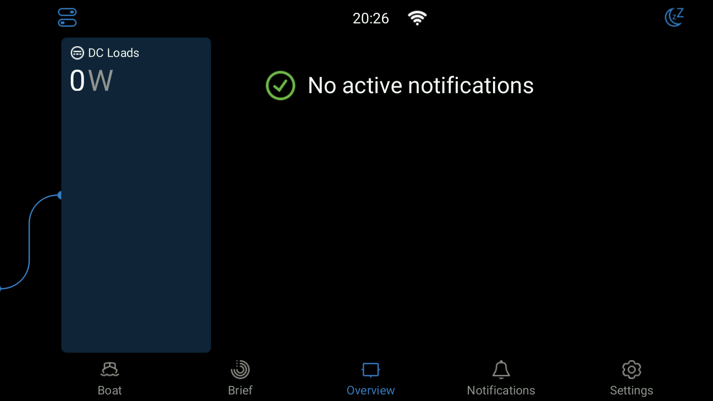
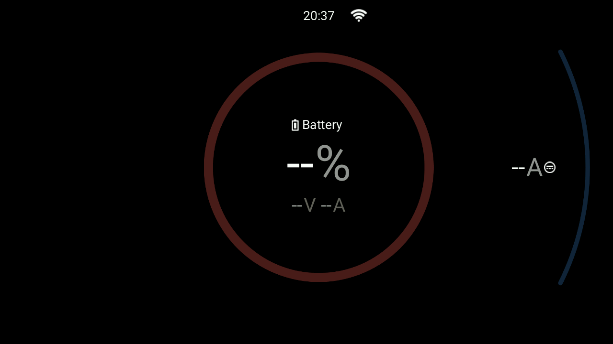

# Waveshare RPI-HMI-7A display on Venus OS (Raspberry Pi 4)

Native support for the built-in 7" DSI touchscreen of the **Waveshare RPI-HMI-7A**
(Waveshare *DSI-TOUCH v2* panel family) on **Victron Energy Venus OS** for the
Raspberry Pi 4. The HMI then works like a GX device with a display: the Venus UI
on the panel, touch, brightness control and display-off timer. Optionally the
new Venus UI (gui-v2, with dark mode) runs on the panel too.

| Overview (gui-v2) | Brief (gui-v2) |
|---|---|
|  |  |

*Framebuffer captures from the panel. No devices were connected to the test
setup, so the values are empty.*

> **Unofficial community project.** Not affiliated with or endorsed by Victron
> Energy, Waveshare or Raspberry Pi Ltd. It loads self-built kernel modules on
> your GX device. Use at your own risk, and keep a backup of your SD card.

## Status

| | Tested with |
|---|---|
| Hardware | Waveshare RPI-HMI-7A: Raspberry Pi 4B (2 GB) + 7" 720×1280 DSI panel (ILI9881C), Goodix GT9271 touch, panel MCU at I²C 0x45 |
| Venus OS | v3.85 `raspberrypi4`, normal and large image |
| Kernel | `5.10.110` (`5.10.110-rpi-venus-8`, 32-bit ARMv7) |

What works:

- **Display.** The panel runs on the KMS stack at 720×1280 (portrait). The Venus UI rotates itself to landscape.
- **Touch.** The Goodix touch controller is read by polling, because the panel has no interrupt line to the Pi.
- **Backlight.** The Venus brightness setting, the display-off timer and wake-on-touch work for both the classic and the new UI.
- **Survives changes.** The setup survives reboots, firmware updates that keep the same kernel, and the switch between the normal and large image. The switch was tested; it is a full rootfs reinstall.
- **Optional gui-v2.** The new UI can run on the panel. After every firmware update it is reinstalled automatically, which was tested by simulating an update. Its dialogs (QR codes, value editors, confirmations) work too, through a landscape virtual framebuffer (see [the gui-v2 section](#optional-the-new-ui-gui-v2-on-the-panel)).

What is untested:

- The other DSI-TOUCH v2 sizes. The overlay has parameters for them (see [Panel options](#panel-options)).
- Other Raspberry Pi models.

## Why it does not work out of the box

- **Old kernel.** Venus OS for the Pi 4 uses kernel 5.10.110. As of v3.85 this is the same in every feed channel (release, candidate, testing, develop). The Waveshare DSI-TOUCH v2 panel driver and its panel-MCU driver exist only in the Raspberry Pi kernel 6.12 and later: [raspberrypi/linux#6566](https://github.com/raspberrypi/linux/pull/6566), with fixes in [#7414](https://github.com/raspberrypi/linux/pull/7414).
- **No KMS overlays.** The Venus Pi 4 image ships no `vc4-kms-v3d*` overlays, so `dtoverlay=vc4-kms-v3d` in `config.txt` silently does nothing. The legacy firmware display stack only detects the official Raspberry Pi 7" display.
- **No touch interrupt.** The Goodix touch controller has no interrupt line to the Pi, and the 5.10 `goodix` driver has no polling mode.
- **Copying files from Raspberry Pi OS does not help.** Copying Waveshare's `.dtbo` gives an overlay without its drivers, and Raspberry Pi OS modules are built for a 6.x kernel.

## What is in this repository

| Path | What it is |
|---|---|
| `driver/panel-waveshare-dsi-v2.c` | Waveshare DSI-TOUCH v2 panel driver, backported from `rpi-6.18.y` to 5.10 |
| `driver/waveshare-panel-regulator.c` | Panel MCU driver: power rails, reset GPIOs and backlight, backported to 5.10 |
| `driver/goodix.c` | Venus' own 5.10 Goodix driver plus the polling mode from `rpi-6.18.y` |
| `driver/dts/` | `vc4-kms-dsi-waveshare-panel-v2` overlay for the 5.10 device tree |
| `driver/patches/` | Diffs of all changes against the upstream sources |
| `scripts/prepare-kernel.sh` | Builds a kernel tree identical to the Venus kernel (source, patches, config, `Module.symvers`) |
| `deploy/install.sh`, `deploy/uninstall.sh` | Installer and uninstaller that run on the GX device |
| `deploy/waveshare-display/waveshare-display.sh` | Boot script, run from `/data/rcS.local` |
| `deploy/waveshare-display/gui-v2-keep.sh` | Optional: installs gui-v2 again after firmware updates |
| `deploy/waveshare-display/gui-v2-qml.patch` | gui-v2 QML fix: puts the on-screen keyboard at the bottom of the UI on the 1280×720 screen |
| `fbrotate/fbrotate.c` | Copies a 1280×720 virtual framebuffer onto the 720×1280 panel, rotated (used with gui-v2) |

## Installation

Requirements:

- Root SSH access to Venus OS. See [Venus OS: Root Access](https://www.victronenergy.com/live/ccgx:root_access).
- Venus OS for the Raspberry Pi 4 with kernel `5.10.110`. Check it with `uname -r`.

Download `venus-os-waveshare-dsi-rpi4-5.10.110.tar.gz` from the Releases page, or
build it yourself (see [Building from source](#building-from-source)). Then:

```sh
scp venus-os-waveshare-dsi-rpi4-5.10.110.tar.gz root@<gx-ip>:/tmp/
ssh root@<gx-ip>
cd /tmp && tar xzf venus-os-waveshare-dsi-rpi4-5.10.110.tar.gz && cd venus-os-waveshare-dsi
./install.sh            # or: ./install.sh --gui-v2   (also run the new UI on the panel)
reboot
```

The installer does four things:

1. It copies the files to `/data/waveshare-display/`.
2. It adds one line to `/data/rcS.local` and keeps any existing lines.
3. It copies the two overlays to `/u-boot/overlays/`.
4. It adds these lines to `/u-boot/config.txt`:

   ```
   dtoverlay=vc4-kms-v3d-pi4
   dtoverlay=vc4-kms-dsi-waveshare-panel-v2,7_0_inch_a
   ```

After the reboot the Venus UI comes up on the panel. You find the brightness
setting and the display-off time in the display settings of the Venus UI.

The installer checks that the device is a `raspberrypi4` and that the running
kernel matches the one the modules were built for. Otherwise it stops.

### Uninstall

Run `./uninstall.sh` from the same directory and reboot.

## Building from source

The host used was Ubuntu 24.04 (x86_64). Install these packages:

```sh
sudo apt install gcc-arm-linux-gnueabihf gcc-13-plugin-dev-arm-linux-gnueabihf \
                 bison flex device-tree-compiler libgmp-dev libmpc-dev libssl-dev bc
```

Then build:

```sh
scripts/prepare-kernel.sh   # ~3 min, ~1.4 GB in ./kernel-src
make -C driver dist         # -> dist/venus-os-waveshare-dsi-rpi4-5.10.110.tar.gz
```

`prepare-kernel.sh` reproduces the Venus kernel build environment:

- [victronenergy/linux](https://github.com/victronenergy/linux) at the commit used by the Venus recipe (`3859262`).
- The 7 patches from [meta-victronenergy](https://github.com/victronenergy/meta-victronenergy). They are GCC 13 and gcc-plugin fixes.
- `.config` and `Module.symvers` from Victron's `kernel-dev` package in the Venus feed.

Modules built in a fresh tree are byte-identical to the ones tested on the
device. Things that matter for a loadable module:

- **GCC plugin.** The Venus kernel uses `CONFIG_GCC_PLUGIN_ARM_SSP_PER_TASK`. Modules must be built with the plugin, otherwise they reference `__stack_chk_guard`, which does not exist, and fail to load. Hence the `gcc-13-plugin-dev` package.
- **MODVERSIONS.** `CONFIG_MODVERSIONS=y`, so the exact `Module.symvers` is needed. The CRCs of the tree were checked against Venus (82/82 match).
- **vermagic.** An empty `.scmversion` keeps `setlocalversion` from appending `+` to the release. Otherwise vermagic would be `5.10.110+` and the kernel would reject the modules.

## How it works

1. **Firmware.** The firmware applies the overlays. U-Boot boots the kernel with the firmware's device tree, so the overlays take effect.
2. **udev.** It loads `vc4` and the stock `goodix`. The DSI part of vc4 waits for its panel (`-EPROBE_DEFER`), so the whole vc4 DRM device waits too.
3. **`/data/rcS.local`.** It runs at the end of rcS, before the GUI starts, and calls `waveshare-display.sh`. The script:
   1. checks the kernel and vermagic, and makes sure the overlays and `config.txt` lines exist;
   2. replaces the stock `goodix` with the polling one;
   3. loads the panel MCU driver and the panel driver with `insmod` from `/data`;
   4. waits for vc4 to bind through deferred probe. `/dev/fb0` (`vc4drmfb`, 720×1280) appears in about 1 s;
   5. mirrors `/etc/venus` to a ramdisk, adds `backlight_device` and `blank_display_device`, and bind-mounts the copy over `/etc/venus`. Venus does the same for `/service`. These are the same files Victron uses for the GX Touch. `venus-platform` then offers the brightness setting, and the GUI blanks the display through `bl_power`.
4. **gui-v2 only.** The script loads `vfb`, which gives a 1280×720 `/dev/fb1`, and starts the supervised `fbrotate` service. It also points gui-v2 at `/dev/fb1`, with Qt rotating the touch input, and bind-mounts two patched QML files so that the on-screen keyboard fits. See the gui-v2 section for why.
5. **GUI.** The GUI starts on `linuxfb`. gui-v1 draws on the panel and rotates its landscape layout itself. gui-v2 sees a landscape screen and does not need to rotate.

Apart from the optional gui-v2 below, the rootfs is never written. The Pi's
firmware update only writes the inactive rootfs partition, and `/u-boot` and
`/data` are left alone, so the display keeps working after updates.

If a future Venus release changes the kernel, the script logs
`kernel ... != 5.10.110` and does not load the modules. They then have to be
rebuilt. If Victron moves the Pi 4 to a 6.x kernel built from `bcm2711_defconfig`,
the upstream driver may already be included.

## Optional: the new UI (gui-v2) on the panel

Venus offers gui-v2 on the local display only if
`/opt/victronenergy/gui-v2/venus-gui-v2` exists. The Raspberry Pi image does
not include it, but the Venus feed has the same `gui-v2` package for this CPU
architecture (`cortexa7hf-neon-vfpv4`).

With `./install.sh --gui-v2`, or by creating `/data/waveshare-display/gui-v2.enabled`,
`gui-v2-keep.sh` runs in the background once the network is up. It:

1. grows the rootfs with Venus' own `resize2fs.sh`, because the large image's rootfs has only about 18 MB free;
2. runs `opkg install start-gui-v2`, which installs 16 packages (about 11 MB download) and replaces `start-gui-v1`;
3. restores the original read-only `fstab`;
4. sets `Settings/Gui/RunningVersion` to 2, so that the browser Remote Console also shows the new UI.

A firmware update removes gui-v2 again. The script then repeats these steps
automatically, and the classic UI is shown until it is done. If the feed is not
reachable, it retries for an hour and then again at the next boot.

gui-v2 draws in software, because the Pi image has no GPU drivers. On the Pi 4
it felt smooth in testing and used about 0 % CPU when idle.

### Dialogs and the landscape framebuffer

On a portrait screen gui-v2 rotates its landscape layout itself. Upstream it
then closes every modal dialog immediately (gui-v2 commit `0b4df0d`, *"auto
reject modal dialogs on rotated displays"*), because the Qt Quick Controls
popup overlay cannot be rotated with the rest of the UI. This hits QR codes,
value editors and confirmations. The upstream TODO is to rotate the whole
surface instead.

This setup does that in software:

- `vfb` provides a 1280×720 RGB565 framebuffer, `/dev/fb1`. gui-v2 draws there (`QT_QPA_PLATFORM=linuxfb:fb=/dev/fb1`), sees a landscape screen and does not rotate. Dialogs work.
- `fbrotate` compares `/dev/fb1` with a shadow copy in bands of 16 rows and copies only changed bands onto the panel (`/dev/fb0`), rotated by 90°. It polls every 33 ms while the screen changes and every 100 ms after 1 s without changes, and pauses while the backlight is off.
- Qt rotates the touch coordinates with `QT_QPA_EVDEV_TOUCHSCREEN_PARAMETERS=rotate=270`.
- The script only changes the gui-v2 service file in `/service`, which is a ramdisk.

Measured on the Pi 4: `fbrotate` uses about 2 % of one core with the screen on
and idle, 0 % with the screen off, and around 10 % while the UI animates.
Create `/data/waveshare-display/no-landscape-fb` to disable this, so that gui-v2
rotates itself again.

### Panel power-off while the display is off (optional)

When Venus blanks the display (the display-off timer), it only turns the backlight
off (`bl_power`). The DSI link, the scanout and the panel's own supplies keep
running, which costs 0.3 to 0.5 W on the Pi 4 (0.31 W in an A/B test, 0.53 W in a
before/after comparison), measured at the battery next to 0.56 W for the backlight at
brightness 52/255. With `fbrotate --dpms` the whole
pipeline is powered down as well:

- Create `/data/waveshare-display/panel-poweroff` (the content is the number of
  seconds to wait after the blanking, default 5; run `waveshare-display.sh` by hand
  or reboot to apply it). `fbrotate` then writes `4` to `/sys/class/graphics/fb0/blank`
  (DPMS off: the panel's `unprepare` cuts IOVCC and AVDD and holds the LCD in reset)
  and `0` as soon as `bl_power` reads `0` again, which the GUI writes on the first
  touch. The touch controller stays powered and polled, so touch still wakes the
  display; the picture comes back about half a second later than with the
  backlight alone.
- The panel driver must be the one from this repository: the 5.10 vc4 DSI
  driver puts the lanes into ULPS before it calls `unprepare`, and the "display
  off" / "sleep in" commands that the upstream `unprepare` sends then time out
  intermittently (`vc4_dsi: transfer interrupt wait timeout`, 1 s, host reset).
  They are not needed because the supplies are cut right after.
- Powering up occasionally fails to initialise the panel (about 1 in 5 to 1 in 10
  power-ups on the test unit): the first DCS command of the init sequence times out
  (`vc4_dsi: transfer interrupt wait timeout`, `instat: 0x00000000`, then
  `waveshare-dsi: failed to init panel: -110`), and the backlight comes on over a panel
  that shows nothing. 5.10 ignores the result of the panel's `prepare`, so `fbrotate`
  reads the kernel log (`/dev/kmsg`) after each power-up and, if the panel driver
  logged that failure, powers the pipeline down and up again (up to 6 attempts, about
  2 s each). A power-down and power-up always recovered it in testing.
- When `fbrotate` stops or is restarted while the panel is powered down, it powers the
  panel up again and puts `bl_power` back to blanked, so the backlight does not stay on
  for a GUI that believes the display is off. After a crash the next instance carries on
  from the state it finds (`bl_power` non-zero means blanked; at start-up it also makes
  sure the pipeline is up if `bl_power` reads 0).
- Remove the file to go back to blanking with the backlight only (run
  `waveshare-display.sh` by hand, or reboot).

### On-screen keyboard

gui-v2 has two fixed layouts, 1024×600 and 800×480, and picks one from the
screen's physical size. Main.qml centres the layout in the window and scales it
to fit, so on 1280×720 the 1024×600 UI is drawn 1.2 times larger, with a
narrow black margin left and right. The on-screen keyboard is not part of the
scaled UI: it lives in the window overlay and is placed as if the window had
exactly the layout's size. On this screen it therefore hung about 150 px past
the left edge and stopped about 70 px above the bottom. Victron's own displays
have the layout's size, so they are not affected.

gui-v2 loads its QML files from `/opt/victronenergy/gui-v2/Victron/` (so that
they can be customised on the device). At boot the script copies two of them to
a ramdisk, applies `gui-v2-qml.patch` and bind-mounts the copies over the
originals:

- `InputPanel.qml` puts the keyboard at the bottom of the UI area.
- `ModalDialog.qml` converts the keyboard position from window coordinates to the
  dialog's coordinates. It uses that position to move a dialog with a focused text
  field above the keyboard.

On a window with the layout's size both changes do nothing. The patch was made
against gui-v2 v1.3.22. If it does not apply to a later version, the script
logs that and leaves the files unchanged.

To switch back to the classic UI:

```sh
rm /data/waveshare-display/gui-v2.enabled
mount -o remount,rw /
opkg install start-gui-v1
dbus -y com.victronenergy.settings /Settings/Gui/RunningVersion SetValue %1
mount -o remount,ro /
reboot
```

## Panel options

The overlay parameters are read from `/data/waveshare-display/panel`. You can
also set them with `./install.sh --panel ...`. The default is `7_0_inch_a`
(RPI-HMI-7A). To change them later, edit the file, run
`/data/waveshare-display/waveshare-display.sh` (it updates `config.txt`) and
reboot.

- **Sizes.** `3_4_inch_c`, `4_0_inch_a`, `4_0_inch_c`, `4_3_inch_a`, `5_0_inch_a`, `5_0_inch_a_v2`, `5_0_inch_b`, `5_5_inch_a`, `6_25_inch_a`, `7_0_inch_a`, `7_0_inch_b`, `7_0_inch_c`, `8_0_inch_a`, `8_8_inch_a`, `9_0_inch_b`, `10_1_inch_a`, `10_1_inch_b`. Only `7_0_inch_a` has been tested. The `_4lane` variants do not apply: the Pi 4 DSI connector has 2 lanes.
- **Touch.** Append `invx`, `invy`, `swapxy` or `disable_touch`, for example `7_0_inch_a,invx`.
- **Upside-down landscape (gui-v2).** Write `ccw` to `/data/waveshare-display/rotation` to turn the picture and the touch input by 180°. The default is `cw`. gui-v1 always uses its own rotation.

## Troubleshooting

- **Log.** Check `/data/log/waveshare-display.log` and the output of `dmesg | grep -iE 'waveshare|dsi|goodix|vc4|drm'`.
- **`panel overlay not active in this boot`.** Reboot once more. The overlays are applied by the firmware at boot.
- **`kernel ... != 5.10.110` or `vermagic mismatch`.** The firmware update changed the kernel. Rebuild the modules.
- **Backlight on, but no image.** Look for `failed to write command` or DSI errors in `dmesg`.
- **Touch mirrored or rotated.** Add `invx`, `invy` or `swapxy` to the panel parameters.
- **Display dark after a reboot, no log entry.** Venus *Modification checks* renames `/data/rcS.local` to `rcS.local.disabled` when modifications are disallowed.
- **Hardware check without drivers.** Add `dtparam=i2c0=on` to `config.txt` and reboot. `i2cdetect -y 10` should then show the MCU at `0x45` and the touch controller at `0x5d`. MCU registers:
  - `0x94`: high byte of the GPIO/power word. Bit 8 is VCC, bit 9 is touch reset.
  - `0x95`: low byte. Bit 0 is AVDD, bit 1 is LCD reset, bit 2 is backlight enable, bit 4 is IOVCC.
  - `0x96`: backlight PWM.
  - `0x97`: panel size; `0x46` means 7.0".

  This turns the backlight on:

  ```sh
  i2cset -y 10 0x45 0x94 0x03; i2cset -y 10 0x45 0x95 0x04; i2cset -y 10 0x45 0x96 0xff
  ```

## Technical notes

### Changes to the drivers

The full diffs are in `driver/patches/`.

- **Panel.** `drm_panel.prepare_prev_first` does not exist in 5.10 and is not needed: 5.10 `vc4_dsi_encoder_enable()` powers up the DSI host before it calls the panel's `pre_enable`/`prepare`. `drm_panel_funcs.get_orientation` was added later and was removed here; the orientation is still set on the connector. `remove()` returns `int`. `unprepare()` does not send the DCS "display off" and "sleep in" commands (see the power-off section: they time out, because 5.10 `vc4_dsi_encoder_disable()` has already put the lanes into ULPS).
- **Panel MCU.** It uses `.probe_new`, `remove()` returns `int`, and `gpio_chip.set` returns `void`.
- **goodix.** Polling mode via `input_setup_polling()` every 17 ms when there is no IRQ, and no IRQ calls in that case.
- **Overlay.** The `dsi0` parameter was removed. It refers to `i2c_csi_dsi0`, which the 5.10 device tree does not have, and an unresolved fixup makes the firmware drop the whole overlay.

### Timing

720×1280 at 83.333 MHz, RGB888 over 2 lanes, is 1 Gbit/s per lane. The 5.10
vc4 DSI driver gets exactly this from PLLD: 3 GHz / 3 = 1 GHz, and 1 GHz / 12 = 83.333 MHz.

## Credits

- **Waveshare** for `panel-waveshare-dsi-v2` and `waveshare-panel-regulator` (GPL-2.0) and the overlay.
- **Raspberry Pi Ltd and the Linux kernel community** for the vc4 DRM driver, the overlays and the Goodix polling mode.
- **Victron Energy** for Venus OS, [meta-victronenergy](https://github.com/victronenergy/meta-victronenergy) and the open-source [gui-v2](https://github.com/victronenergy/gui-v2).

## License

GPL-2.0, see [LICENSE](LICENSE). The kernel modules are derived from Linux
kernel code. Victron Energy, Venus OS, Waveshare and Raspberry Pi are trademarks
of their respective owners.
